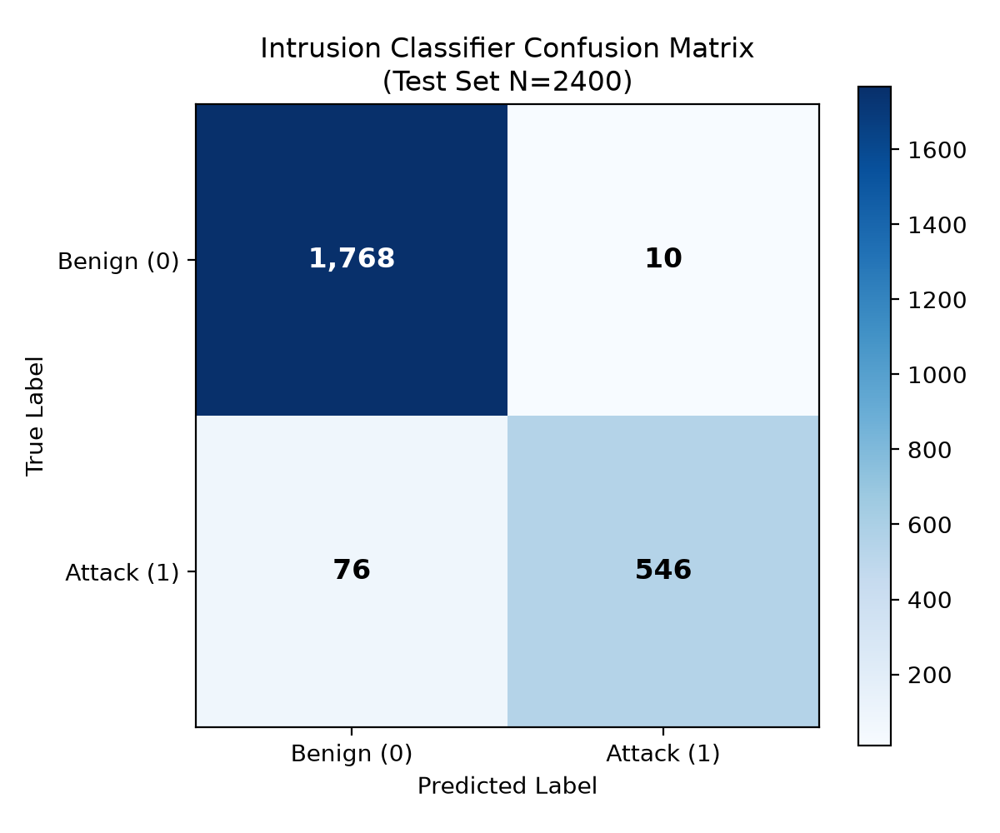
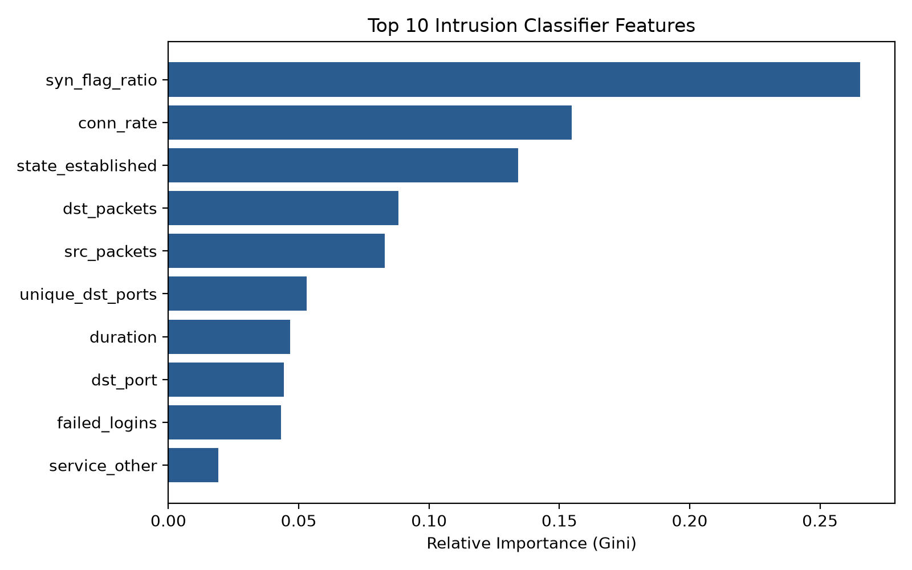
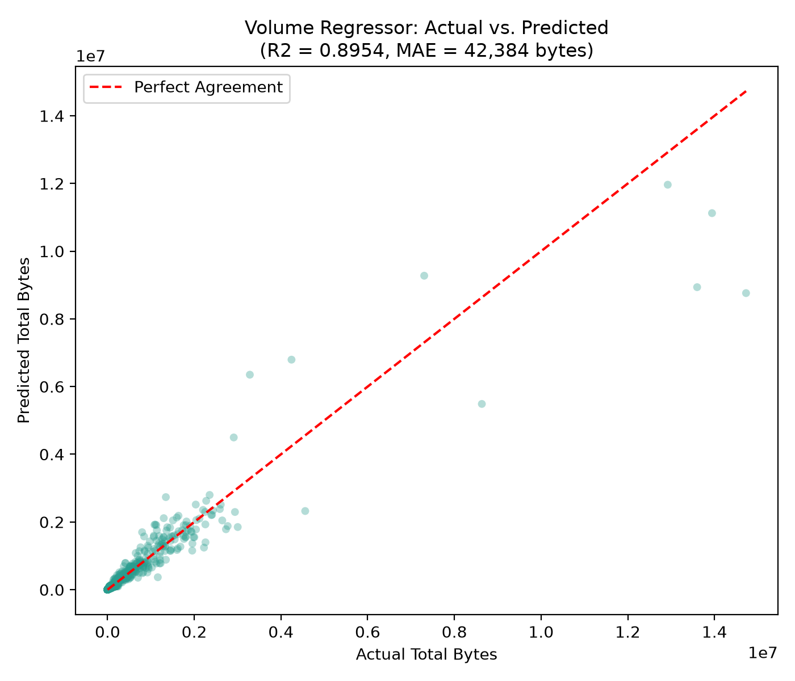

# 🛡️ ThreatLens AI

### Intelligent Network Intrusion Detection & Flow Volume Analysis Using MongoDB and Machine Learning

[](https://www.python.org/)
[](https://www.mongodb.com/)
[](https://pymongo.readthedocs.io/)
[](https://scikit-learn.org/)
[](https://streamlit.io/)
[](tests/)
[](ThreatLens-AI-Submission.zip)

---

## 📌 Executive Summary

**ThreatLens AI** is an academic prototype and software submission developed for the B.Tech curriculum in **"Intelligent NoSQL Databases" (CSE494)**. 

Modern enterprise networks generate massive volumes of heterogeneous packet telemetry. Conventional relational database management systems (RDBMS) suffer from severe throughput bottlenecks during high-velocity write bursts, exhibit schema rigidity across variable protocol headers (TCP vs. UDP vs. ICMP), and incur expensive relational `JOIN` penalties during multi-table analytics. 

ThreatLens AI solves these challenges by combining:
1. **Intelligent Document-Oriented Storage**: MongoDB document modeling with PyMongo, featuring idempotent bulk upserts, compound B-tree indexing, and server-side aggregation pipelines (`$group`, `$lookup`, `$match`, `$sort`).
2. **Dual-Task Machine Learning Engine**:
   - **Intrusion Classifier (`RandomForestClassifier`)**: Binary cyber attack detection achieving **96.42% accuracy** and an **F1-score of 0.9270** (vs. a 74.08% naive baseline).
   - **Flow Volume Regressor (`RandomForestRegressor`)**: Total payload byte estimation for capacity planning achieving an **$R^2$ score of 0.8954** and **MAE of 42,383 bytes** (an 83.6% error reduction over mean baseline).
3. **Comprehensive Interface & Verification**: Unified CLI inference, an interactive 4-tab **Streamlit dashboard**, a 35-test **pytest suite**, and an automated **academic Word report generator** ([project_report.docx](reports/project_report.docx)).

---

## 📦 Submission Deliverable

The official academic submission package is bundled as a single self-contained ZIP archive:
* 📥 **[Download ThreatLens-AI-Submission.zip](ThreatLens-AI-Submission.zip)** *(23.4 MB compressed, 90.6 MB uncompressed, 42 files)*
* 📄 **[Academic Project Report (.docx)](reports/project_report.docx)** *(240 KB, 16 sections, styled tables, and embedded high-resolution plots)*
* 🔍 **[Requirements Traceability Matrix](docs/traceability.md)**
* 📋 **[Step-by-Step Verification Checklist](docs/VERIFICATION_CHECKLIST.md)**
* 🎓 **[Oral Viva Defense Preparation Guide](docs/VIVA_QA.md)**

---

## 📑 Table of Contents

- [Executive Summary](#-executive-summary)
- [Submission Deliverable](#-submission-deliverable)
- [⚡ 6-Command Windows Quick Start](#-6-command-windows-quick-start)
- [System Architecture](#-system-architecture)
- [Dataset & Attack Taxonomy](#-dataset--attack-taxonomy)
- [MongoDB NoSQL Design & PyMongo Integration](#-mongodb-nosql-design--pymongo-integration)
- [Machine Learning Pipelines & Mathematical Design](#-machine-learning-pipelines--mathematical-design)
- [Empirical Evaluation Results](#-empirical-evaluation-results)
- [Visual Diagnostic Plots](#-visual-diagnostic-plots)
- [CLI Inference & Prediction Engine](#-cli-inference--prediction-engine)
- [Streamlit Web Dashboard](#-streamlit-web-dashboard)
- [Automated Testing Suite (Pytest)](#-automated-testing-suite-pytest)
- [Curriculum Traceability Matrix](#-curriculum-traceability-matrix)
- [Viva Voce Defense FAQs](#-viva-voce-defense-faqs)
- [License & Academic Provenance Notice](#-license--academic-provenance-notice)

---

## ⚡ 6-Command Windows Quick Start

Open **PowerShell** (or Command Prompt) inside the project root:

```powershell
# 1. Create a dedicated Python virtual environment
python -m venv .venv

# 2. Activate environment (includes execution policy bypass for PowerShell)
Set-ExecutionPolicy -Scope Process Bypass; .\.venv\Scripts\Activate.ps1

# 3. Install tested, pinned dependencies
pip install -r requirements.txt

# 4. Initialize environment configuration
copy .env.example .env

# 5. Start native Windows MongoDB service
net start MongoDB

# 6. Execute complete automated pipeline (seed DB, train models, evaluate, demo, test)
scripts\run_all.bat
```

To launch the real-time interactive graphical dashboard:
```powershell
streamlit run app.py
```
Open **[http://localhost:8501](http://localhost:8501)** in your web browser.

---

## 🏗️ System Architecture

```
                    ┌───────────────────────────────────────────────┐
                    │  Synthetic Traffic Generator (seed=42)        │
                    │  scripts/generate_data.py (12,000 flows)      │
                    └───────────────────────┬───────────────────────┘
                                            │
                                            ▼
                    ┌───────────────────────────────────────────────┐
                    │  Data Validation & 80/20 Stratified Split     │
                    │  src/data_loader.py & src/preprocessing.py    │
                    └───────────────────────┬───────────────────────┘
                                            │
                                            ▼
                    ┌───────────────────────────────────────────────┐
                    │  Idempotent Bulk Upsert Engine (PyMongo)      │
                    │  src/seed_database.py (UpdateOne, batch=1000) │
                    └───────────────────────┬───────────────────────┘
                                            │
                                            ▼
                     ===============================================
                       MONGODB DATABASE LAYER: threatlens_db
                     ===============================================
                       ├── traffic_records (12,000 documents)
                       │   ├── uniq_record_id (record_id: 1)
                       │   ├── compound_label_attack (label: 1, attack_type: 1)
                       │   └── idx_split (split: 1)
                       ├── predictions (Inference snapshots + $lookup join)
                       │   ├── compound_rec_model (record_id: 1, model_version: 1)
                       │   └── idx_created_at_desc (created_at: -1)
                       └── model_metrics (Evaluation governance & baselines)
                     =======================┬=======================
                                            │
                     ┌──────────────────────┴──────────────────────┐
                     ▼                                             ▼
       ┌───────────────────────────┐                 ┌───────────────────────────┐
       │   Intrusion Classifier    │                 │   Flow Volume Regressor   │
       │   RandomForestClassifier  │                 │   RandomForestRegressor   │
       │   Target: label (0 / 1)   │                 │   Target: total_bytes     │
       │   12 Features (No Bytes)  │                 │   10 Features (No Labels) │
       └─────────────┬─────────────┘                 └─────────────┬─────────────┘
                     │                                             │
                     └──────────────────────┬──────────────────────┘
                                            │
                                            ▼
                    ┌───────────────────────────────────────────────┐
                    │  Model Evaluation & Diagnostic Engine         │
                    │  src/evaluate.py                              │
                    │  ├── outputs/metrics.json                     │
                    │  ├── outputs/confusion_matrix.png             │
                    │  ├── outputs/classifier_feature_importance.png│
                    │  └── outputs/regressor_actual_vs_predicted.png│
                    └───────────────────────┬───────────────────────┘
                                            │
                     ┌──────────────────────┴──────────────────────┐
                     ▼                                             ▼
       ┌───────────────────────────┐                 ┌───────────────────────────┐
       │     CLI Prediction        │                 │    Streamlit Dashboard    │
       │     src/predict.py        │                 │    app.py (4-Tab UI)      │
       │  --record-id | --sample   │                 │  Live Predict, Records,   │
       │  --input-json             │                 │  Metrics & DB Aggregations│
       └───────────────────────────┘                 └───────────────────────────┘
```

---

## 📊 Dataset & Attack Taxonomy

The dataset contains **12,000 synthetic network flow records** deterministically generated using NumPy (`default_rng(seed=42)`). The distribution closely mirrors real-world telemetry while maintaining class imbalance:

| Attack Category | MITRE / Domain Classification | Flow Count | Proportion | Distinguishing Signature |
| :--- | :--- | :---: | :---: | :--- |
| **Normal** | Benign Baseline | 9,000 | 75.00% | Established TCP/UDP connections across HTTP/HTTPS/DNS with low SYN ratios and normal packet sizes. |
| **DoS** | Denial of Service | 1,200 | 10.00% | Extremely high `src_packets` (500–5,000), tiny `dst_packets` (0–5), elevated `conn_rate`, high `syn_flag_ratio` (>0.80), short duration, `state=syn_sent`. |
| **Port Scan** | Network Reconnaissance | 840 | 7.00% | High `unique_dst_ports` (35–600), minimal packets per connection, `state=rejected` or `reset`. |
| **Brute Force** | Credential Access | 600 | 5.00% | SSH (port 22) / FTP (port 21), high `failed_logins` (5–45), moderate connection rates. |
| **Probe** | Discovery Scanning | 360 | 3.00% | ICMP echo or low-rate multi-port probes across low-order ports with moderate unique destinations. |

### Realistic Difficulty Mechanisms
1. **8% Stealthy Attacks**: Attack flows drawn from normal parameter distributions to challenge model boundaries.
2. **5% Bursty Benign Flows**: Benign connections exhibiting elevated transmission rates (downloads/streaming).
3. **2% Telemetry Noise**: Random label perturbations simulating real-world packet sensor noise.

---

## 🗄️ MongoDB NoSQL Design & PyMongo Integration

### Collection Schemas

#### 1. `traffic_records` Collection (Document per Flow)
```json
{
  "_id": {"$oid": "6ae3837d88145769f070dae4"},
  "record_id": "TL-000001",
  "duration": 0.3541,
  "protocol": "tcp",
  "service": "https",
  "state": "established",
  "src_packets": 28,
  "dst_packets": 35,
  "dst_port": 443,
  "ttl": 64,
  "failed_logins": 0,
  "syn_flag_ratio": 0.0357,
  "unique_dst_ports": 1,
  "conn_rate": 8.45,
  "src_bytes": 14200,
  "dst_bytes": 35800,
  "total_bytes": 50000,
  "label": 0,
  "attack_type": "normal",
  "split": "train",
  "source": "synthetic",
  "imported_at": {"$date": "2026-10-29T23:03:19.000Z"}
}
```

#### 2. `predictions` Collection (Inference Snapshot Audit)
```json
{
  "_id": {"$oid": "6ae3841c91b55dea36061159"},
  "record_id": "TL-000001",
  "input_snapshot": {
    "duration": 0.3541,
    "protocol": "tcp",
    "service": "https",
    "state": "established",
    "src_packets": 28,
    "dst_packets": 35,
    "dst_port": 443,
    "ttl": 64,
    "failed_logins": 0,
    "syn_flag_ratio": 0.0357,
    "unique_dst_ports": 1,
    "conn_rate": 8.45
  },
  "predicted_label": 0,
  "attack_probability": 0.0364,
  "predicted_total_bytes": 48950.25,
  "actual_label": 0,
  "actual_total_bytes": 50000.0,
  "model_version": "1.0.0",
  "source": "stored_record",
  "created_at": {"$date": "2026-10-29T23:06:24.000Z"}
}
```

### PyMongo Technical Implementation
- **Idempotent Ingestion**: Ingests in batches of 1,000 using `UpdateOne({"record_id": doc["record_id"]}, {"$set": doc}, upsert=True)`. Re-running seeding modifies records in-place without changing document count.
- **Relational Joins (`$lookup`)**: Demonstrates joins between `predictions` and `traffic_records` by value matching on `record_id`.
- **Server-Side Aggregations**: Computes flow counts, average durations, and byte totals across attack types in MongoDB.
- **Type Safety**: `to_native()` converts `numpy.int64`, `numpy.float64`, and ndarrays to Python primitives before insertion.
- **Serialization**: `serialize()` converts `ObjectId` and `datetime` to JSON-safe primitives.
- **Index Plan Inspection**: Verified `EXPRESS_IXSCAN` stage via `.explain("executionStats")`.

---

## 🤖 Machine Learning Pipelines & Mathematical Design

### 1. Data Isolation & Leakage Prevention
- **Stratified Partitioning**: 80/20 train/test split seeded with `RANDOM_SEED=42` stored directly in the `split` column.
- **Zero Identifier / Target Leakage**: `assert_no_leakage()` guarantees that identifiers (`record_id`), byte targets, and ground truth labels never contaminate feature matrices.
- **Imputer Isolation**: `SimpleImputer(strategy='median')` is fitted exclusively on training rows and applied statically to test rows.
- **Feature Scaling**: Random Forests are invariant to monotonic scaling; scaling was omitted to preserve raw feature interpretability and eliminate numerical rounding.

### 2. Feature Sets
- **Intrusion Classifier Features (12)**: `duration`, `protocol`, `service`, `state`, `src_packets`, `dst_packets`, `dst_port`, `ttl`, `failed_logins`, `syn_flag_ratio`, `unique_dst_ports`, `conn_rate`.
- **Flow Volume Regressor Features (10)**: `duration`, `protocol`, `service`, `state`, `src_packets`, `dst_packets`, `dst_port`, `ttl`, `unique_dst_ports`, `conn_rate` *(Excludes security flags and labels)*.

---

## 📈 Empirical Evaluation Results

All metrics were evaluated exclusively on the held-out 20% test partition ($N=2,400$ flows):

### Intrusion Detection Classifier Performance
$$\text{Accuracy} = \frac{TP + TN}{TP + TN + FP + FN} = \frac{546 + 1768}{2400} = 96.42\%$$
$$\text{Precision} = \frac{TP}{TP + FP} = \frac{546}{546 + 10} = 98.20\%$$
$$\text{Recall} = \frac{TP}{TP + FN} = \frac{546}{546 + 76} = 87.78\%$$
$$\text{F1-Score} = 2 \times \frac{\text{Precision} \times \text{Recall}}{\text{Precision} + \text{Recall}} = 0.9270$$

| Metric | ThreatLens AI Random Forest | Naive Dummy Baseline (`most_frequent`) | Performance Lift |
| :--- | :---: | :---: | :---: |
| **Accuracy** | **96.42%** | 74.08% | $+22.34\%$ |
| **Precision** | **98.20%** | 0.00% | $+98.20\%$ |
| **Recall** | **87.78%** | 0.00% | $+87.78\%$ |
| **F1-Score** | **0.9270** | 0.0000 | $+0.9270$ |

### Flow Volume Regressor Performance
$$R^2 = 1 - \frac{\sum (y_i - \hat{y}_i)^2}{\sum (y_i - \bar{y})^2} = 0.8954$$
$$\text{MAE} = \frac{1}{n} \sum_{i=1}^n |y_i - \hat{y}_i| = 42,383.86\text{ Bytes}$$

| Metric | ThreatLens AI Regressor | Baseline Dummy Regressor (`mean`) | Error Reduction |
| :--- | :---: | :---: | :---: |
| **$R^2$ Score** | **0.8954** | -0.0017 | $+0.8971$ |
| **Mean Absolute Error (MAE)** | **42,383.86 Bytes** | 258,411.06 Bytes | **$-83.6\%$ error reduction** |

---

## 🖼️ Visual Diagnostic Plots

Generated programmatically via matplotlib's `Agg` backend:

### 1. Confusion Matrix (Test Set $N=2,400$)


### 2. Classifier Feature Importance (Top 10 Gini Impurity)


### 3. Regressor Actual vs. Predicted Agreement


---

## 💻 CLI Inference & Prediction Engine

Run predictions on arbitrary flows from PowerShell or Command Prompt:

```powershell
# 1. Fetch flow from MongoDB by unique record ID and predict
python -m src.predict --record-id TL-000001

# 2. Sample 5 random flows from the test split and evaluate
python -m src.predict --sample 5

# 3. Predict an arbitrary flow dictionary from a JSON file
python -m src.predict --input-json data/sample_input.json

# 4. Predict without persisting results to MongoDB
python -m src.predict --input-json data/sample_input.json --no-store
```

---

## 🖥️ Streamlit Web Dashboard

The Streamlit web application ([app.py](app.py)) provides an intuitive UI across four tabs:
1. **🎯 Predict Tab**: Manual feature inputs, real-time intrusion probability bar, predicted byte volume metric, and batch sampling.
2. **📋 Records Tab**: MongoDB collection browser with attack-type and service filters.
3. **📊 Metrics Tab**: Real-time evaluation cards, baseline comparison statistics, and diagnostic plots.
4. **🔍 DB Queries Tab**: Server-side MongoDB aggregation charts and index inspection.

Launch command:
```powershell
streamlit run app.py
```

---

## 🧪 Automated Testing Suite (Pytest)

The project includes **35 unit and integration tests** executing on a dedicated throwaway database (`threatlens_test_db`):

```powershell
pytest -v
```

*Results Summary:*
* `tests/test_data_generation.py`: **6 passed**
* `tests/test_data_loader.py`: **8 passed**
* `tests/test_database.py`: **6 passed**
* `tests/test_models.py`: **4 passed**
* `tests/test_predict.py`: **3 passed**
* `tests/test_preprocessing.py`: **8 passed**
* **Total**: **35 passed, 0 failed, 0 skipped** (Execution time: 4.75 seconds).

---

## 📋 Curriculum Traceability Matrix

| Requirement | Implementation Modules | Automated Unit Tests | Status |
| :--- | :--- | :--- | :---: |
| **1. MongoDB with PyMongo** | `src/database.py`, `src/seed_database.py`, `src/db_demo.py` | `tests/test_database.py` (6 tests) | **PASS** |
| **2. At Least One ML Model** | `src/train_classifier.py`, `src/train_regressor.py` | `tests/test_models.py` (4 tests) | **PASS** |
| **3. Classification Metrics (Acc, Prec, Rec, F1)** | `src/evaluate.py::evaluate_classifier`, `src/predict.py` | `tests/test_models.py`, `tests/test_predict.py` | **PASS** |
| **4. Regression Metrics (R², MAE)** | `src/evaluate.py::evaluate_regressor`, `src/predict.py` | `tests/test_models.py` | **PASS** |
| **5. Report & Deliverable ZIP** | `scripts/make_report.py`, `scripts/make_zip.py` | [project_report.docx](reports/project_report.docx), [ZIP](ThreatLens-AI-Submission.zip) | **PASS** |

---

## 🎓 Viva Voce Defense FAQs

*See [docs/VIVA_QA.md](docs/VIVA_QA.md) for the complete 9-question examination defense guide.*

* **Q: Why MongoDB over PostgreSQL?**  
  *A: Network telemetry exhibits high ingestion velocity and protocol-dependent attributes. MongoDB's document model avoids sparse tables and expensive multi-table JOINs, while enabling high-throughput bulk upserts and embedded inference audit snapshots.*
* **Q: Why is Accuracy misleading at 75% benign / 25% attack?**  
  *A: A naive classifier predicting benign for 100% of flows achieves 74.08% accuracy while failing to detect a single cyber attack (0% Recall, 0% Precision). F1-Score (0.9270) and Recall (87.78%) are the true operational metrics.*
* **Q: How was Data Leakage prevented?**  
  *A: Fixed 80/20 stratified split assigned before modeling, imputer statistics fitted exclusively on training rows, target exclusion asserted via `assert_no_leakage()`, and monotonic scaling omitted.*
* **Q: What is the mandatory regression disclosure?**  
  *A: In this synthetic dataset, packet bytes are generated from packet counts and service packet sizes. The high $R^2$ (0.8954) demonstrates pipeline correctness rather than human-level payload estimation skill on unconstrained real-world Internet connections.*

---

## 📜 References & Citations

1. **Moustafa, N., & Slay, J. (2015)**. *UNSW-NB15: A comprehensive data set for network intrusion detection systems*. IEEE Military Communications and Information Systems Conference (MilCIS), Canberra, Australia.
2. **Sharafaldin, I., Lashkari, A. H., & Ghorbani, A. A. (2018)**. *Toward generating a new dataset for intrusion detection systems*. Proceedings of the International Conference on Information Systems Security and Privacy (ICISSP), Portugal.
3. **Scikit-learn Developers (2024)**. *Scikit-learn: Machine Learning in Python*. Documentation (v1.9). [https://scikit-learn.org/](https://scikit-learn.org/)
4. **MongoDB Inc. (2024)**. *MongoDB Community Server Documentation (v7.0/v8.0)*. MongoDB Manual. [https://www.mongodb.com/docs/manual/](https://www.mongodb.com/docs/manual/)
5. **PyMongo Developers (2024)**. *PyMongo: Python Driver for MongoDB*. Documentation (v4.19). [https://pymongo.readthedocs.io/](https://pymongo.readthedocs.io/)

---

## ⚖️ Academic Provenance Notice

This project utilizes **synthetic demonstration data** generated deterministically (`seed=42`, 12,000 flows) for academic submission in course CSE494. It does not represent proprietary production telemetry.
